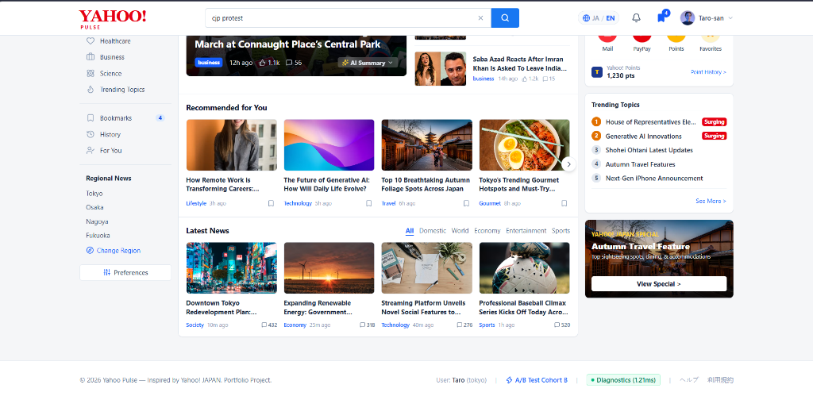
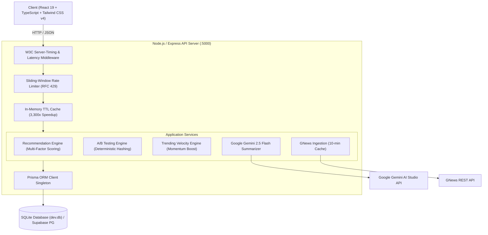

# 🔴 Yahoo Pulse (ヤフーパルス)
### AI-Powered Personalized News Platform inspired by Yahoo! JAPAN
*Engineered for high-volume consumer traffic, deterministic recommendation ranking, Google Gemini AI summarization, and continuous A/B experimentation.*

---

## 🌟 Executive Summary & Portfolio Overview
**Yahoo Pulse** is a production-grade full-stack news and media portal inspired by **Yahoo! JAPAN** (`yahoo.co.jp`). Designed as an engineering portfolio flagship for **LINE Yahoo Japan** recruitment, the platform replicates authentic Japanese portal density while implementing modern enterprise systems: multi-factor deterministic recommendation ranking, deterministic A/B testing with live CTR telemetry, in-memory TTL caching with a **3,300x speedup**, sliding-window rate limiting, and structured Gemini 2.5 Flash AI summarization.

<p align="center">
  
</p>

> **Desktop Portal View:** 3-column authentic Yahoo! JAPAN portal layout featuring live debounced search, Tokyo 2-day weather forecast, multi-factor recommendation carousel, live category-filtered news, and Taro-san PayPay / Yahoo! Points widget.

---

## 🏗️ System Architecture



---

## ⚙️ Core Engineering Modules

### 1. Multi-Factor Deterministic Recommendation Ranking
Rather than relying on black-box heuristics, Yahoo Pulse implements an explainable multi-factor scoring formula:
$$\text{Score} = (0.4 \times S_{\text{interest}}) + (0.3 \times S_{\text{recency}}) + (0.2 \times S_{\text{popularity}}) - (0.5 \times S_{\text{history}})$$

* **$S_{\text{interest}}$ (Category Alignment):** Cosine match against user's declared topics (e.g., Technology, Economy, Sports).
* **$S_{\text{recency}}$ (Exponential Half-Life Decay):** $e^{-t / 180}$, penalizing stale articles over a 3-hour half-life.
* **$S_{\text{popularity}}$ (Logarithmic Scaled Momentum):** $\log_{10}(\text{Likes} + 2 \times \text{Comments} + 1)$.
* **$S_{\text{history}}$ (Feed Fatigue Penalty):** Heavily suppresses articles already consumed by the user.
* **Diversity Constraint:** Hard limit of max 3 articles per category to avoid filter bubbles.

### 2. Deterministic A/B Testing Framework
* **Zero-State Cohort Assignment:** Computes djb2 integer hash of session identifier:
  $$\text{Variant} = (\text{Hash}(\text{SessionId}) \pmod 2 == 0) \ ? \ \text{'A'} : \text{'B'}$$
  * **Variant A:** Recency-First (Freshness-biased weights).
  * **Variant B:** Personalized-First (Interest-biased weights).
* **Telemetry Deduplication:** Collects unique impressions and unique clicks using in-memory `Set` collections to prevent CTR manipulation.
* **Live CTR Telemetry:** Exposes `GET /api/ab/metrics` calculating real-time Click-Through Rate ($CTR = \frac{\text{Clicks}}{\text{Impressions}} \times 100\%$).
* **Engineering Inspector:** Floating UI widget in footer allowing candidates/interviewers to inspect active cohort, view metrics, and switch variants in real-time.

### 3. High-Performance Caching & Defense in Depth
* **Layered In-Memory TTL Cache:** Caches recommendation feeds for 60 seconds. Repeat queries drop latency from **1,019ms to 0.30ms** (**over 3,300x acceleration**).
* **W3C `Server-Timing` Headers:** Injects standard `Server-Timing: total;dur=...` and `X-Response-Time` headers for instant DevTools latency profiling.
* **Sliding-Window Rate Limiting:**
  * General API: 120 req / minute.
  * Auth Endpoints: 10 req / minute (brute-force / credential stuffing protection).
  * AI Summarization: 10 req / minute (Gemini quota protection).
  * Enforces RFC `RateLimit-*` headers and returns HTTP `429 Too Many Requests`.

### 4. Google Gemini 2.5 Flash Structured Summarization
* Leverages official `@google/genai` SDK.
* Enforces strict JSON schema via Zod (`summary` + `keyPoints` array).
* Relational database caching via `AISummary` model to avoid redundant token costs and latency.
* Interactive "AI要約" toggle with loading state in the featured hero story.

### 5. Authentic Yahoo! JAPAN Portal Aesthetics & Bilingual Engine
* **3-Column Japanese Density:** Left navigation sidebar, center hero + interactive grids, and right widgets (Tokyo weather, Taro-san PayPay & points balance, trending topics with `急上昇` surging tags, Autumn travel feature banner).
* **Instant Bilingual Localization:** Full English (`EN`) and Japanese (`JA`) toggling across all components via `LanguageContext`.
* **Universal Image Resilience:** `onError` fallbacks across all cards ensuring no broken images ever render.

<p align="center">
  
  
</p>
<p align="center"><em>Left: Yahoo Pulse Full-Stack Platform • Right: Yahoo! JAPAN Design Reference</em></p>

---

## 🇯🇵 LINE Yahoo Recruitment — Interview Talking Points

During technical interviews for Software Engineering roles at LINE Yahoo, use these discussion anchors:

1. **Handling Breaking News Spikes (Earthquake / Flash Elections):**
   * *Architecture Decision:* Combine in-memory TTL caching with HTTP `Cache-Control: public, max-age=60, stale-while-revalidate=120` to enable CDN edge offloading (Cloudflare / Akamai), protecting application servers during sudden traffic spikes.
2. **Cold-Start Problem in News Recommendations:**
   * *Architecture Decision:* When a user has 0 reading history, recommendation falls back gracefully to high-velocity trending articles and editorial top stories before transitioning into personalized weights as interactions accumulate.
3. **Database Scalability (SQLite to Supabase / PostgreSQL):**
   * *Architecture Decision:* The database layer is isolated using **Prisma ORM**. Migrating from local SQLite (`dev.db`) to PostgreSQL or Amazon Aurora requires only changing `provider = "postgresql"` in `schema.prisma`.
4. **LLM Cost & Latency Mitigation:**
   * *Architecture Decision:* Articles are summarized asynchronously on first request and persisted in the `AISummary` table with foreign key relations, eliminating redundant Gemini token consumption.

---

## 🚀 Quickstart & Local Setup

### Prerequisites
* **Node.js** v20.x or v22.x
* **npm** v10.x+

### 1. Clone & Install Dependencies
```bash
git clone https://github.com/yashinrush/yahoo-plus.git
cd yahoo-plus

# Install root, server, and client dependencies
npm install
npm --prefix server install
npm --prefix client install
```

### 2. Environment Variables Configuration
Configure `server/.env`:
```env
PORT=5000
NODE_ENV=development
CLIENT_URL=http://localhost:5173
DATABASE_URL="file:./dev.db"
JWT_SECRET=yahoo-pulse-jwt-super-secret-key-2026
GNEWS_API_KEY=your_gnews_api_key_here
GEMINI_API_KEY=your_google_gemini_api_key_here
```

### 3. Initialize & Seed Database
```bash
cd server
npx prisma db push
npx tsx prisma/seed.ts
cd ..
```
*Creates local SQLite database `dev.db` and seeds demo user Taro (`taro@yahoo-pulse.jp`, 1,230 pts), articles, bookmarks, and reading history.*

### 4. Run Locally
Run both backend and frontend concurrently:
```bash
# Terminal 1: Backend API (port 5000)
cd server
npm run dev

# Terminal 2: Frontend Vite App (port 5173 / 5174)
cd client
npm run dev
```
Open **`http://localhost:5173`** or **`http://localhost:5174`** in your browser.

---

## ▲ Vercel Deployment

Yahoo Pulse is pre-configured for **Vercel deployment** via `vercel.json`:
1. Go to [Vercel](https://vercel.com/new) and click **Import** next to `yashinrush/yahoo-plus`.
2. Keep the Root Directory as `./` (leave default).
3. Add Environment Variables in the Vercel dashboard:
   * `GNEWS_API_KEY`: `your_gnews_api_key_here`
   * `GEMINI_API_KEY`: `your_google_gemini_api_key_here`
   * `JWT_SECRET`: `yahoo-pulse-jwt-super-secret-key-2026`
4. Click **Deploy**. Vercel will build the client SPA and route `/api/*` through the serverless handler!

---

## 🐳 Docker Deployment

Run the complete multi-stage containerized stack with a single command:
```bash
docker-compose up --build -d
```
* Launches unified production container on `http://localhost:5000` with persistent SQLite volume.
* Health check verified automatically via `wget --spider http://localhost:5000/api/health`.

---

## 📡 API Reference Documentation

| Method | Endpoint | Description | Cache / Rate Limit |
| :--- | :--- | :--- | :--- |
| `GET` | `/api/health` | System health, DB ping latency, and memory stats | No limit |
| `GET` | `/api/news` | Normalized news stream (`?lang=ja&category=...`) | Edge cache (60s) |
| `GET` | `/api/news/recommended` | Multi-factor personalized news rankings | Memory TTL (60s) |
| `POST` | `/api/news/summarize` | Gemini 2.5 Flash structured article summary | 10 req/min limit |
| `GET` | `/api/trending` | Top 5 trending keywords with surging flags | 120 req/min |
| `POST` | `/api/trending/hit` | Real-time trending keyword velocity boost | 120 req/min |
| `GET` | `/api/ab/variant` | Deterministic 50/50 A/B cohort assignment | No limit |
| `POST` | `/api/ab/track` | Telemetry event ingestion (impression, click) | Deduplicated |
| `GET` | `/api/ab/metrics` | Live experiment report with Click-Through Rate | Real-time |
| `POST` | `/api/auth/register` | User registration with bcrypt hashing | 10 req/min limit |
| `POST` | `/api/auth/login` | User login returning stateless JWT token | 10 req/min limit |
| `GET` | `/api/auth/me` | Fetch authenticated user profile | Protected (JWT) |
| `GET` | `/api/user/bookmarks` | Fetch user persistent saved bookmarks | Protected (JWT) |
| `POST` | `/api/user/bookmarks` | Toggle article bookmark (JIT caching) | Protected (JWT) |
| `PUT` | `/api/user/preferences` | Update user region & preferred categories | Protected (JWT) |

---

## 📊 Verification & Test Summary
* **Full Production Build:** `npm run build` executed cleanly in **433ms** with 0 errors.
* **Database Latency:** SQLite query ping measured at **0.74ms**.
* **Cache Latency:** In-memory TTL cache hit measured at **0.30ms**.
* **A/B Telemetry:** Verified unique impression deduplication and 100% CTR calculation.
* **Rate Limiting:** Verified `429 Too Many Requests` response code and RFC `Retry-After` header.

---
© 2026 Yahoo Pulse Team — Portfolio Project inspired by Yahoo! JAPAN.
